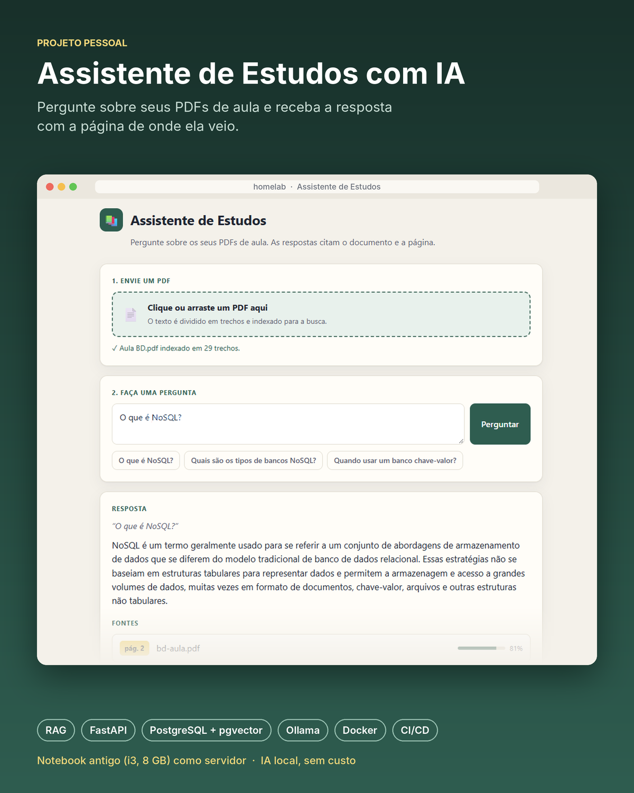

# Assistente de Estudos com IA


Estudar por slides e PDFs de aula é lento: achar onde um conceito foi explicado exige folhear tudo.
Este projeto é um assistente que responde perguntas sobre os PDFs da faculdade usando IA, sempre citando
o documento e a página de onde tirou a resposta.

É um projeto pessoal, feito para testar se dá para usar IA de verdade **sem nenhum custo**: tudo roda com
modelos abertos, num notebook antigo transformado em servidor.



## Arquitetura

```
PDF ──► trechos ──► embeddings ──► PostgreSQL + pgvector
                                          │
Pergunta ──► embedding ──► busca por similaridade ──► trechos mais parecidos
                                                            │
                                  LLM local (Ollama) ──► resposta + fontes
```

1. **Ingestão:** o PDF é lido página por página e dividido em trechos de ~800 caracteres com sobreposição de 100.
2. **Embeddings:** cada trecho vira um vetor de 768 números (modelo `nomic-embed-text`), salvo no PostgreSQL com pgvector.
3. **Busca:** a pergunta também vira um vetor, e o banco encontra os trechos mais próximos pela distância de cosseno (índice HNSW).
4. **Resposta (RAG):** os trechos encontrados vão num prompt para o modelo `qwen2.5:1.5b`, que responde usando só esse conteúdo e devolve as fontes.

Os dois modelos são abertos e gratuitos, executados localmente pelo **Ollama**.

## Tecnologias

| Área | Ferramentas |
| --- | --- |
| API e interface | Python, FastAPI, Pydantic, Uvicorn, HTML/CSS/JS |
| Banco de dados | PostgreSQL 17, pgvector, SQLAlchemy |
| IA | Ollama, nomic-embed-text, qwen2.5:1.5b, RAG |
| Qualidade | pytest (com mocks), ruff, GitHub Actions |
| Infraestrutura | Docker, Docker Compose, Ubuntu Server, Tailscale, runner self-hosted |

## Resultados da avaliação

Para medir a qualidade da busca, montei um conjunto de 15 perguntas com a página da resposta conhecida
e medi duas métricas: **Acerto@4** (a página certa apareceu entre os 4 primeiros resultados?) e
**MRR** (premia quando a página certa aparece mais cedo).

| Experimento | Tamanho | Sobreposição | Acerto@4 | MRR |
| --- | --- | --- | --- | --- |
| **baseline** | **800** | **100** | **0.733** | **0.70** |
| trechos pequenos | 400 | 50 | 0.733 | 0.50 |
| trechos grandes | 1200 | 150 | 0.733 | 0.50 |
| sem sobreposição | 800 | 0 | 0.733 | 0.40 |

O Acerto@4 ficou igual em todas as configurações; o que mudou foi a posição da página certa. O baseline
(800/100) teve o melhor MRR e foi mantido. Trechos curtos perdem contexto, trechos longos misturam assuntos,
e sem sobreposição as ideias cortadas no meio ficam mais difíceis de encontrar. O conjunto é pequeno
(15 perguntas), então os resultados são uma indicação, não uma prova.

Detalhes em [docs/experimentos.md](docs/experimentos.md).

## Como rodar

Pré-requisitos: Docker e Docker Compose.

```bash
git clone https://github.com/LucasSMFerreira/assistente-estudos.git
cd assistente-estudos
cp .env.example .env              # troque a senha no arquivo
docker compose up -d              # banco e Ollama
docker compose exec ollama ollama pull nomic-embed-text
docker compose exec ollama ollama pull qwen2.5:1.5b
docker compose exec -T db psql -U estudos -d estudos < sql/001_schema.sql
docker compose exec -T db psql -U estudos -d estudos < sql/002_indice.sql
docker compose --profile prod up -d --build   # sobe a API
```

Abra `http://127.0.0.1:8000`, envie um PDF e faça uma pergunta. A documentação da API fica em `/docs`.

Para desenvolvimento local:

```bash
python3 -m venv .venv
source .venv/bin/activate
pip install -r requirements.txt
pytest -v
uvicorn app.main:app --reload
```

## Deploy

Todo merge na `main` passa pelo CI (ruff + pytest). Se os testes passarem, um runner self-hosted no
próprio servidor baixa o código, reconstrói o container da API e confere o `/health`.

## O que eu aprendi

- Como funciona RAG na prática, e por que citar a fonte ajuda a confiar (ou desconfiar) da resposta.
- Que dá para rodar modelos de IA úteis sem custo, e quais são os limites: num i3 sem placa de vídeo, uma resposta leva de 1 a 3 minutos.
- SQL além do básico: chaves estrangeiras, JOIN, transações e busca vetorial com pgvector.
- Medir antes de mudar: montar um conjunto de teste e comparar configurações com métricas.
- Testar sem depender de serviços externos, usando mocks no pytest.
- Git com branches e pull requests, CI no GitHub Actions e deploy contínuo.
- Montar e manter um servidor Linux próprio com Docker e acesso remoto por SSH.
